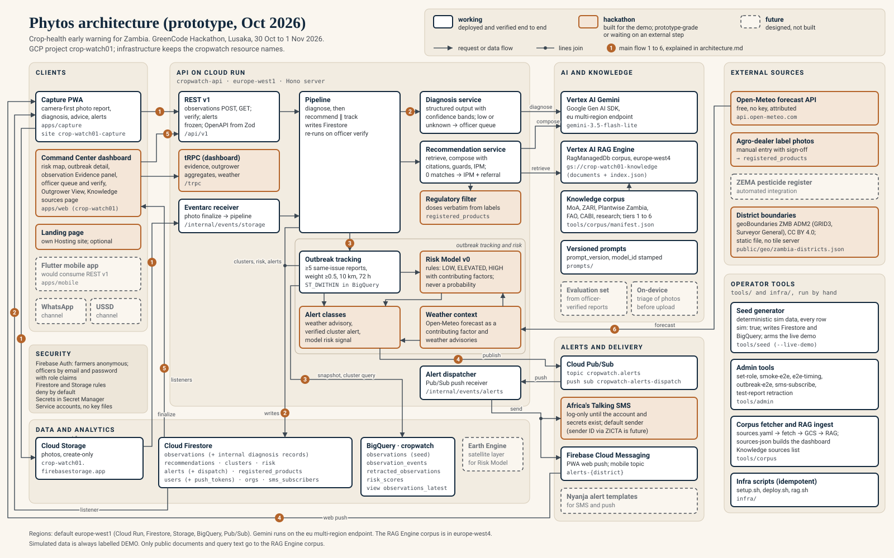

# Phytos architecture

Phytos (formerly CropWatch) is a crop-health early-warning prototype for Zambia, built for the GreenCode Hackathon (Lusaka, 30 Oct to 1 Nov 2026). This page describes the system as of 29 Oct 2026. The product name changed; the GCP project and resource names did not (`crop-watch01`, `cropwatch-api`, `cropwatch.alerts`, and so on).

## Legend

Every box in the diagram has one of three statuses.

| Status        | Drawn as                                 | Meaning                                                                                                                                 |
| ------------- | ---------------------------------------- | --------------------------------------------------------------------------------------------------------------------------------------- |
| **working**   | white box, solid navy border             | Deployed and verified end to end.                                                                                                       |
| **hackathon** | light copper box, solid copper border    | Built for the hackathon demo. Prototype-grade, or waiting on an external step such as an account, a credential or a label confirmation. |
| **future**    | paper box, dashed grey border, grey text | Designed, not built.                                                                                                                    |

Connectors are orthogonal arrows in the direction the request or data moves. A small dot marks where two lines join (writes from the pipeline and from outbreak tracking share one line into Firestore; the dispatcher's line splits to SMS and FCM). Copper badges 1 to 6 mark the main flows described below. Grey rounded panels are layers; the thin frame inside the API groups the outbreak-tracking and risk components.

Some relationships are written in the boxes rather than drawn, to keep lines from crossing: the regulatory filter reads `registered_products`, agro-dealer label photos feed `registered_products`, the operator tools name their targets, and Earth Engine would feed the Risk Model.

## Main flows

1. **Capture.** The farmer takes a photo in the Capture PWA. The PWA uploads it straight to Cloud Storage (create-only rules), then calls `POST /api/v1/observations` on the API, which starts the pipeline. Storage also emits a finalize event; Eventarc delivers it to `/internal/events/storage`, which starts the same pipeline for that observation. Each pipeline step acts only on its own status and is idempotent, so a duplicate trigger does no harm.
2. **Diagnose and recommend.** The pipeline calls the Diagnosis service, which sends the photo and context to Gemini and gets back structured output; low confidence or `unknown` sends the observation to the officer queue. The Recommendation service then retrieves passages from the RAG Engine corpus for the crop, issue, stage and district, has Gemini compose advice with citations, applies deterministic guards and the regulatory filter, and orders the result on the IPM ladder. The pipeline writes the diagnosis and recommendation to Firestore, and the PWA's Firestore listener shows them to the farmer.
3. **Track.** In parallel with the recommendation, outbreak tracking writes an observation snapshot to BigQuery (`observation_events`) and runs the cluster rule there: at least 5 same-issue reports with evidence weight at least 0.5 within 10 km and 72 hours (`ST_DWITHIN`). It writes clusters, district risk and alerts to Firestore. A tracking failure is logged and never holds up the farmer's result.
4. **Alert.** A new alert is written to Firestore and its id published to the Pub/Sub topic `cropwatch.alerts`. The push subscription `cropwatch-alerts-dispatch` delivers it to the dispatcher at `/internal/events/alerts`, which claims it in a transaction (a redelivery never sends twice) and sends FCM web push to PWA tokens for the district, the FCM topic `alerts-{district}` for the mobile app, and SMS through Africa's Talking.
5. **Dashboard and verification.** The Command Center reads Firestore through listeners and calls tRPC for evidence, Outgrower aggregates and weather context. When an officer verifies or corrects a diagnosis, the dashboard calls the REST verify endpoint, the pipeline re-runs for that observation, and the verified counter goes up.
6. **Weather.** The Weather context service reads the Open-Meteo forecast. The forecast becomes a contributing factor in the Risk Model and the source of weather advisory alerts.

## Clients

| Component                                                          | What it does                                                                                                                                                                                                                                                                                                                                                                                                                                                                                      | Status                      |
| ------------------------------------------------------------------ | ------------------------------------------------------------------------------------------------------------------------------------------------------------------------------------------------------------------------------------------------------------------------------------------------------------------------------------------------------------------------------------------------------------------------------------------------------------------------------------------------- | --------------------------- |
| Capture PWA (`apps/capture`, Hosting site `crop-watch01-capture`)  | The primary demo client. Camera-first photo report, then diagnosis and advice, area alerts, and FCM web push. Uses only the frozen REST v1 contract and Firestore listeners, as the mobile app would.                                                                                                                                                                                                                                                                                             | working                     |
| Command Center dashboard (`apps/web`, Hosting site `crop-watch01`) | National risk map, outbreak detail, observation detail with the Evidence panel, officer queue and verify with a live verified counter, Outgrower View, and the Knowledge sources page. The Outgrower View (DEMO OUTGROWER CO.) shows per-officer visit lists and camp or district aggregates only, never precise farm locations. District boundaries for the map are a static file, so the map needs no tile server. The Knowledge sources page reads `apps/web/src/data/knowledge-sources.json`. | hackathon (being built now) |
| Landing page (separate Hosting site)                               | Public page for the project. Optional; may not ship.                                                                                                                                                                                                                                                                                                                                                                                                                                              | hackathon                   |
| Flutter mobile app (`apps/mobile`)                                 | Would consume the frozen REST v1 contract from `packages/shared/src/contracts/openapi.json`. Outside the pnpm workspace.                                                                                                                                                                                                                                                                                                                                                                          | future                      |
| WhatsApp channel, USSD                                             | Reporting and alerts over WhatsApp, and over USSD on basic phones.                                                                                                                                                                                                                                                                                                                                                                                                                                | future                      |

## API on Cloud Run

One Cloud Run service, `cropwatch-api`, in europe-west1: a Hono server that wraps the tRPC router library in `apps/functions`.

| Component                                      | What it does                                                                                                                                                                                                                                                                                                        | Status    |
| ---------------------------------------------- | ------------------------------------------------------------------------------------------------------------------------------------------------------------------------------------------------------------------------------------------------------------------------------------------------------------------- | --------- |
| REST v1 (`/api/v1`)                            | Create and read observations, verify, alerts. Frozen contract: after Day 2 it only gains optional fields. The OpenAPI file is generated from the Zod schemas in `packages/shared`.                                                                                                                                  | working   |
| tRPC (`/trpc`)                                 | Dashboard-only queries: evidence, Outgrower aggregates, weather context.                                                                                                                                                                                                                                            | hackathon |
| Eventarc receiver (`/internal/events/storage`) | Accepts Storage finalize events signed by the trigger account; starts the pipeline for photos under `observations/`, ignores other objects.                                                                                                                                                                         | working   |
| Alert dispatcher (`/internal/events/alerts`)   | Pub/Sub push receiver; claims each alert once and sends FCM and SMS.                                                                                                                                                                                                                                                | working   |
| Pipeline                                       | Diagnose, then recommend and track in parallel. Writes results to Firestore. Re-runs on officer verify.                                                                                                                                                                                                             | working   |
| Diagnosis service                              | Gemini `gemini-3.5-flash-lite` through the Google Gen AI SDK on Vertex AI, `eu` multi-region endpoint. Structured output against the controlled vocabulary. Confidence is shown only as a qualitative band. Confidence below 0.6 or `unknown` sets `needs_expert_review` and queues the observation for an officer. | working   |
| Recommendation service                         | Context-shaped retrieval from the RAG Engine corpus, Gemini composition with citations, deterministic guards, then the regulatory filter and the IPM ladder. Zero registered matches gives IPM-only advice and an officer referral.                                                                                 | working   |
| Regulatory filter                              | Deterministic filter against `registered_products`; doses are rendered verbatim from the label, never by the model. Real rows wait on label confirmation; placeholder rows are gated off.                                                                                                                           | hackathon |
| Outbreak tracking                              | BigQuery snapshot, then the cluster rule (at least 5 same-issue reports, weight at least 0.5, 10 km, 72 h, `ST_DWITHIN`), then clusters, risk and alerts in Firestore.                                                                                                                                              | working   |
| Risk Model v0                                  | Rule-based LOW, ELEVATED or HIGH per district, always stored and shown with its contributing factors. Never a probability. Prototype rules, not validated.                                                                                                                                                          | hackathon |
| Weather context                                | Open-Meteo forecast as a contributing factor and as the source of weather advisories.                                                                                                                                                                                                                               | hackathon |
| Alert classes                                  | Weather advisory, verified cluster alert, model risk signal.                                                                                                                                                                                                                                                        | hackathon |

## AI and knowledge

| Component                                                                            | What it does                                                                                                                                                                                                         | Status  |
| ------------------------------------------------------------------------------------ | -------------------------------------------------------------------------------------------------------------------------------------------------------------------------------------------------------------------- | ------- |
| Vertex AI Gemini (`eu` multi-region endpoint)                                        | Diagnosis and recommendation composition. Model `gemini-3.5-flash-lite`, configurable through `GEMINI_MODEL`.                                                                                                        | working |
| Vertex AI RAG Engine (RagManagedDb, europe-west4) with `gs://crop-watch01-knowledge` | Retrieval corpus. The bucket (europe-west1) holds the documents and `index.json`, which the API reads for document metadata. Only public documents and query text (crop, issue, stage, district) go to europe-west4. | working |
| Knowledge corpus                                                                     | Zambia Ministry of Agriculture, ZARI and Plantwise Zambia guides, FAO, CABI and research papers, ranked in tiers 1 to 6. Manifest `tools/corpus/manifest.json`; sources `tools/corpus/fetch/sources.yaml`.           | working |
| Versioned prompts (`prompts/`)                                                       | Prompt files with a version; `prompt_version` and `model_id` are stamped on every diagnosis.                                                                                                                         | working |
| Evaluation set                                                                       | Officer-verified observations become test cases ("every correction becomes a test case"). No automatic learning.                                                                                                     | future  |
| On-device triage                                                                     | Quick check on the phone before upload.                                                                                                                                                                              | future  |

## Data and analytics

| Component                                          | What it does                                                                                                                                                                                                                                                                                                              | Status  |
| -------------------------------------------------- | ------------------------------------------------------------------------------------------------------------------------------------------------------------------------------------------------------------------------------------------------------------------------------------------------------------------------- | ------- |
| Cloud Firestore (europe-west1)                     | `observations` (with internal diagnosis and recommendation records that clients cannot read), `recommendations`, `clusters`, `risk`, `alerts` (with internal dispatch state), `registered_products`, `users` (with `push_tokens`), `orgs`, `sms_subscribers`. Clients read through listeners under deny-by-default rules. | working |
| Cloud Storage (`crop-watch01.firebasestorage.app`) | Observation photos. Create-only for clients.                                                                                                                                                                                                                                                                              | working |
| BigQuery dataset `cropwatch`                       | `observations` (seed), `observation_events` (API snapshots), `retracted_observations`, `risk_scores`, and the view `observations_latest`. The cluster rule runs here.                                                                                                                                                     | working |
| Earth Engine satellite layer                       | Would add satellite signals to the Risk Model.                                                                                                                                                                                                                                                                            | future  |

## Alerts and delivery

| Component                | What it does                                                                                                                                                                              | Status    |
| ------------------------ | ----------------------------------------------------------------------------------------------------------------------------------------------------------------------------------------- | --------- |
| Cloud Pub/Sub            | Topic `cropwatch.alerts` and push subscription `cropwatch-alerts-dispatch` to the dispatcher.                                                                                             | working   |
| Firebase Cloud Messaging | Web push to PWA tokens registered for a district; topic `alerts-{district}` for the mobile app.                                                                                           | working   |
| Africa's Talking SMS     | SMS to `sms_subscribers` for the district. Logs what it would send until the account and its secrets exist. Uses the default sender; a registered sender ID through ZICTA is future work. | hackathon |
| Nyanja alert templates   | Alert copy in Nyanja for SMS and push.                                                                                                                                                    | future    |

## External sources

| Component                | What it does                                                                                                                                                                            | Status    |
| ------------------------ | --------------------------------------------------------------------------------------------------------------------------------------------------------------------------------------- | --------- |
| Open-Meteo forecast API  | Free forecast, no key, attributed. Feeds Weather context.                                                                                                                               | hackathon |
| Agro-dealer label photos | Product labels photographed at agro-dealers and entered into `registered_products` by hand, with sign-off.                                                                              | hackathon |
| ZEMA pesticide register  | Automated sync of the national register into `registered_products`.                                                                                                                     | future    |
| District boundaries      | geoBoundaries ZMB ADM2 (GRID3 and the Office of the Surveyor General, CC BY 4.0), stored as the static file `apps/web/public/geo/zambia-districts.json` and shipped with the dashboard. | hackathon |

## Operator tools

Run by hand from a laptop with Application Default Credentials. They are not deployed.

| Component                                      | What it does                                                                                                                                                                                                                                                                                                                                                                                                              | Status  |
| ---------------------------------------------- | ------------------------------------------------------------------------------------------------------------------------------------------------------------------------------------------------------------------------------------------------------------------------------------------------------------------------------------------------------------------------------------------------------------------------- | ------- |
| Seed generator (`tools/seed`)                  | Deterministic simulated data in Firestore and BigQuery; every row carries `sim: true`. `--live-demo` arms the live demo.                                                                                                                                                                                                                                                                                                  | working |
| Admin tools (`tools/admin`)                    | `set-role`, `smoke-e2e`, `e2e-timing`, `outbreak-e2e`, `sms-subscribe`, and retraction of test reports.                                                                                                                                                                                                                                                                                                                   | working |
| Corpus fetcher and RAG ingest (`tools/corpus`) | `fetch-corpus` fetches the sources in `sources.yaml` and writes the manifest. `ingest` uploads new or changed documents and `index.json` to `gs://crop-watch01-knowledge` and imports them into the RAG Engine corpus that `infra/rag.sh` provisions. `sources-json` builds the dashboard's `knowledge-sources.json` from `sources.yaml`, `manifest.json` and the live `index.json` (42 curated targets, 26 retrievable). | working |
| Infra scripts (`infra/`)                       | `setup.sh`, `deploy.sh`, `rag.sh`; idempotent. All infrastructure changes go through these scripts.                                                                                                                                                                                                                                                                                                                       | working |

## Security

- **Identity.** Firebase Auth. Farmers sign in anonymously; officers use email and password and carry role claims (set with `set-role`). Officer and admin routes check the claims.
- **Rules.** Firestore and Storage rules deny by default. Clients cannot read internal diagnosis, recommendation or dispatch records. Photos are create-only.
- **Secrets.** In Secret Manager, never in code or committed env files.
- **Service identity.** Cloud Run, Eventarc and Pub/Sub use service accounts; Eventarc and Pub/Sub push requests carry OIDC tokens that the API checks. No service account key files are downloaded.
- **Farmer data.** Consented and access-controlled. Precise locations never appear in Outgrower or commercial views; those views show camp and district aggregates only.

## Rules the code enforces

These do not appear as boxes but shape several of them.

- The model never decides whether a pesticide is legal or what dose to use. The regulatory filter does, and doses come verbatim from the label.
- Risk is LOW, ELEVATED or HIGH with its contributing factors. No numeric outbreak probability appears anywhere.
- Model confidence is internal. The UI shows a qualitative band, never a percentage.
- "Where to buy" lists every registered option for the issue, appears only after the recommendation, and is never filtered by sponsor.
- Simulated data is always labelled DEMO.

## Regions

- Default region: europe-west1 for Cloud Run, Firestore, Cloud Storage, BigQuery and Pub/Sub.
- Gemini: the `eu` multi-region endpoint, because europe-west1 serves no current Gemini model.
- RAG Engine corpus: europe-west4, because RagManagedDb is allowlist-only in europe-west1. Remove it after the hackathon with `infra/rag-teardown.sh`.

## Updating the diagram

`architecture.svg` is plain SVG. When a component changes status, change its box class (`bw` working, `bh` hackathon, `bf` future) and the matching row on this page. Keep connectors to horizontal and vertical segments, and check the file still renders on GitHub in both light and dark mode.
