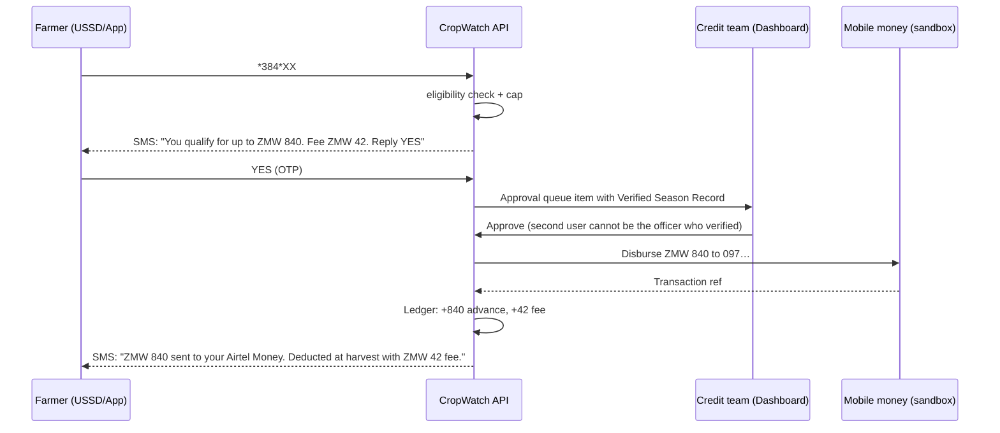

# CropWatch × CEIH — Workflows and MVP Spec (v0.1)

> **Purpose:** turn the CEIH pitch (Crop verification → Eligibility → Instant disbursement → Harvest reconciliation) into concrete workflows and a buildable MVP on top of what CropWatch already has. Written for Claude Code and the team. Companion to `technicaldoc.md` and `buildplan.md`; where this file adds or changes something, it says so explicitly in §8.
>
> **Date:** Saturday 31 October 2026, GreenCode Hackathon, Lusaka. Demo is tomorrow.

---

## 0. What changes, in one paragraph

CropWatch stays what it is: geotagged, AI-assessed, officer-verified observations of what is happening on a farm, now watched continuously from space. The field officer's GPS pin tells the satellite where to look; Sentinel-2 then tracks the field's greenness every few days, and officers go only where the curve says something is wrong. What changes is what those observations are _for_. Until now they fed a pest map. From now on they also feed a **Verified Season Record** per contracted farmer, and that record is what unlocks a capped mid-season cash advance from the agribusiness to the farmer, and what settles the account at harvest. Detection is still the data-collection mechanism. The product is now: _the agribusiness can see its season, so it can safely give farmers the January cash that stops side-selling._

**One deliberate scoping decision for the MVP:** CropWatch is the verification and ledger layer. **The agribusiness's own money funds the advance.** It already lends inputs; the advance is one more tranche on the same contract, released against evidence instead of hope. CropWatch does not lend its own capital and is not an insurer in the MVP. That keeps us out of Bank of Zambia money-lending licensing and PIA insurance licensing for the demo, and it is the version a real agribusiness can pilot in January without us raising a balance sheet first. The pitch can still describe the "fintech layer" future; the demo shows the mechanism.

---

## 1. Actors

| Actor                                            | Where they touch the system                                                     | What they need from it                                                                    |
| ------------------------------------------------ | ------------------------------------------------------------------------------- | ----------------------------------------------------------------------------------------- |
| **Farmer (outgrower)** — e.g. Given, soya, Monze | Feature phone (USSD/SMS) first; Android app second                              | Know if they qualify, request the advance, get the cash, see a clear statement at harvest |
| **Field officer**                                | Flutter app (existing) + officer mode                                           | Register farmers, verify inputs and crop, do the visit list the dashboard gives them      |
| **Agribusiness credit / finance team**           | Dashboard                                                                       | Approve advances with evidence in front of them; see exposure; reconcile at harvest       |
| **Field operations manager**                     | Dashboard                                                                       | Which camps and farms need a visit this week (existing Outgrower View)                    |
| **Depot / weighbridge clerk**                    | Dashboard (or a tablet form)                                                    | Enter delivered weight and grade; the system does the arithmetic                          |
| **System**                                       | Cloud Run services, Firestore, BigQuery, Africa's Talking, mobile-money adapter | Enforce rules, keep the ledger, send every SMS                                            |
| **Insurer** (later, not MVP)                     | Export only                                                                     | Camp-level verified records paired with weather triggers                                  |

---

## 2. The season as seven workflows

### W0 · Enrolment and contract setup (Oct–Nov)

**Trigger:** agribusiness starts the season.

1. Credit team uploads the farmer roster (CSV): farmer name, phone, camp/district, crop, contracted hectares, input loan value (ZMW), projected yield (t/ha), contract price (ZMW/t). System computes **projected harvest value** = ha × yield × price.
2. Field officer visits each farmer, in the app: confirms identity and phone, records **consent** (data shared with the contracting agribusiness; aggregated beyond it), drops a **field pin** and either walks the boundary or records the claimed hectares against the pin.
3. System creates `farmers/{id}` and `contracts/{id}`, opens a ledger with the input loan as the first debit.

**Output:** a contract with a known exposure and a mapped field. **Problem this answers:** ghost farmers, inflated hectares, no farmer registry.

### W1 · Input delivery verification (Nov)

1. Officer records the handover: photo of the inputs, quantities against the input package, farmer confirms by **SMS OTP** typed into the officer's app.
2. Ledger shows inputs as _delivered and acknowledged_ rather than merely _issued_.

**Problem this answers:** disputes at harvest over what was received; the first entry in the accountability record.

### W2 · Crop verification — the "C" (Dec, repeated through the season)

Satellite-led, with the field officer as ground truth. The GPS pin from W0 defines the field polygon; from then on the field is watched from above every few days without anyone driving to it.

1. **Pin → polygon.** The enrolment pin (plus walked boundary or claimed hectares as a buffer) becomes a field polygon stored on the contract. Satellites cannot find the field on their own; the pin is what tells them where to look.
2. **Satellite time series per field.** Sentinel-2 (10 m, roughly every 5 days, free) through Earth Engine gives NDVI (greenness) and a cloud mask for each polygon. The system stores a point per pass: `{ date, ndvi, cloud_pct }`. The field's curve is compared with (a) the crop calendar from the planting date and (b) the camp median curve.
3. **What the curve tells the agribusiness.** Flat near bare-soil NDVI past the expected emergence date → _not planted_. Rising with the camp median → _established, on track_. Falling while the camp median rises → _stress on this field only_ (pest, weeds, neglect). Falling with the camp median → _shared shock_ (drought); this is the same signal that feeds W5.
4. **Protection check.** Field photos and `/diagnose` are still how pests and diseases are identified; satellites see stress, not species. A field whose curve drops gets a **visit task** in the officer's list; the officer's geotagged photos and `/verify` confirm what the satellite flagged and record the intervention. Farmer self-reports via app or WhatsApp/SMS land on the same record.
5. **Rainy-season reality.** December–January is Zambia's cloudiest period, so some passes return nothing. The record shows the gap. If no usable pass lands within the verification window, the officer visit is the fallback and the agribusiness sees which farms were verified from space and which from the ground.

**Output:** a **Verified Season Record** per farmer: inputs delivered → planted (satellite) → stage checks (satellite curve + officer photos) → issues and interventions, each entry with its verification state and source (`satellite`, `officer`, `farmer`, `ai`).

**Problem this answers:** the black box, at a cost the agribusiness can afford. Satellites make every field visible every week; officers go only where the satellite says something is wrong.

### W3 · Eligibility and capping — the "E" (Dec/Jan)

A deterministic rule engine, not a model. Transparent factors, consistent with the no-probabilities golden rule.

**Eligible if all of:**

- Contract active, consent recorded, mobile-money number verified.
- **Crop established**, evidenced by either: (a) satellite — at least two cloud-free passes in the last **21 days** with field NDVI above the crop's establishment threshold and within tolerance of the camp median; or (b) ground — a `FIELD_VERIFIED` observation in the same window with stage ≥ threshold (e.g. soya V3+). Satellite alone is enough when passes are clean; a visit is required when they are not.
- Any observation used passes the geofence check against the field polygon.
- No open issue with `severity_pct ≥ 40` that has no recorded intervention (an open severe pest problem pauses the advance until the officer records treatment).
- No prior-season default flag on the farmer record.

**Cap:** `advance_cap = min(cap_pct × projected_harvest_value, hard_ceiling)` where `cap_pct` is set per agribusiness, default **15%**, range 10–20%, and `hard_ceiling` is a ZMW amount the credit team sets. Both are configuration, shown on the approval screen.

**Output:** `GET /farmers/{id}/eligibility` → `{ eligible, cap_zmw, factors[] }` where `factors` is a human-readable list such as _"Satellite: 3 clear passes, NDVI 0.52 vs camp 0.49, on calendar · Field verified 4 Dec by Officer M. Banda, stage V4 · No open severe issues · Cap 15% of ZMW 5,600 = ZMW 840"_. The dashboard shows the factors, never a score.

**Problem this answers:** advances go only to real, planted, tended fields, so the agribusiness is not throwing good money after bad.

### W4 · Advance request, approval and disbursement — the "I" (Jan)



Rules: farmer sees the fee **before** confirming; a human approves every disbursement (maker-checker: verifier ≠ approver); amounts live only in the ledger; one advance per farmer per season in MVP.

**Problem this answers:** Given's January liquidity gap, closed before the briefcase buyer arrives, with the agribusiness in control of the money.

### W5 · Mid-season monitoring and shock handling (Jan–Apr)

1. Officers keep visiting by the risk-ranked visit list; observations keep landing on farmer records.
2. **Shock trigger:** a camp-level rule combining rainfall (CHIRPS/ZMD 30-day total below threshold) with the camp median NDVI falling across most fields sets `shock_flag = drought` on every contract in that camp, with the data behind it stored. Two independent sources agreeing is what makes the flag defensible to an insurer.
3. A shock flag does three things: pauses further advances in the camp, marks the farmer's eventual shortfall as **uncontrollable** in the ledger, and generates a **claim pack** (camp, affected contracts, verified records, trigger data) for an insurer. In the MVP the payout is simulated and labelled as such.
4. A shortfall on a farm with _no_ shock flag and _no_ verified problem is marked **unexplained** and surfaced to the credit team as a probable diversion or side-sale.

**Problem this answers:** the controllable/uncontrollable split the agribusiness could never make before; the ground truth that lowers basis risk for parametric cover.

### W6 · Harvest reconciliation — the "H" (May–Jul)

1. Depot clerk enters a **delivery**: farmer, weight, moisture, grade. System prices it at the contract price for that grade.
2. Ledger settles automatically: gross value − input loan − advance − advance fee = **net payout**; agribusiness volume fee computed on recovered value (for the model, not charged to the farmer).
3. Net payout to mobile money; SMS statement to the farmer with every line.
4. **Delivery variance:** delivered tonnes vs projected (adjusted for any shock flag). Large unexplained variance → `side_sell_suspected` flag; farmer record updated for next season's eligibility.

**Problem this answers:** disputed deductions, invisible side-selling, and the double loss made legible.

### W7 · Season close and farmer history

Each contract closes with: recovery rate, delivered vs projected, shock flags, interventions, verification count. This becomes the farmer's history and feeds W0 eligibility next season. Camp and district roll-ups feed the agribusiness's portfolio view and, aggregated, any future insurer or lender conversation.

---

## 3. MVP for the demo (build on what exists, in this order)

Everything below assumes the existing pieces work: observations, `/diagnose`, `/verify`, Firestore live map, Outgrower View, SMS via Africa's Talking, seed generator.

### 3.1 Data model additions (Firestore)

```
farmers/{farmerId}
  name, phone_msisdn, momo_provider: "airtel" | "mtn", org_id, camp, district
  consent: { given_at, scope: "org_contract", officer_id }
  field_pin: geopoint, field_polygon: geojson | null, claimed_ha: number
  history: { seasons: number, defaults: number, last_recovery_pct: number | null }
  sim: boolean

contracts/{contractId}
  farmer_id, org_id, season: "2026/27", crop
  contracted_ha, projected_yield_t_ha, contract_price_zmw_t
  projected_value_zmw                    // computed
  input_loan_zmw, inputs_delivered: { at, photo_path, otp_confirmed }
  status: "active" | "settled" | "defaulted"
  shock_flag: null | { type: "drought", camp, triggered_at, evidence_ref }
  side_sell_suspected: boolean

observations/{obsId}                     // EXISTING + three fields
  farmer_id: string | null
  geofence_ok: boolean | null
  source: "officer" | "farmer" | "satellite_task"   // why this observation exists

satellite_metrics/{contractId}/passes/{date}
  ndvi: number, ndvi_camp_median: number, cloud_pct: number, usable: boolean
  collection: "S2_SR_HARMONIZED", computed_at
  status_derived: "not_planted" | "established" | "field_stress" | "shared_stress" | "no_data"
  sim: boolean

advances/{advanceId}
  contract_id, farmer_id, org_id
  requested_at, requested_via: "ussd" | "app" | "officer"
  eligibility_snapshot: { eligible, cap_zmw, factors[] }   // frozen at request
  amount_zmw, fee_zmw
  farmer_confirmed: { at, otp_ok }
  approval: { approver_id, at } | null    // approver_id != verifying officer
  disbursement: { provider, tx_ref, at, status: "pending" | "sent" | "failed" | "simulated" }

ledger_entries/{entryId}
  contract_id, at, type: "input_loan" | "advance" | "advance_fee" | "delivery" | "insurance_payout" | "payout"
  amount_zmw (signed), ref, note

deliveries/{deliveryId}
  contract_id, at, weight_kg, moisture_pct, grade, price_zmw_t, value_zmw, clerk_id

weather_triggers/{triggerId}
  camp, window_start, window_end, metric: "rain_mm_30d", value, threshold, fired: boolean, source
```

### 3.2 API additions (Cloud Run / tRPC + REST adapter)

```
POST /farmers                       create farmer (officer) — consent + pin + phone
POST /contracts/import              CSV roster → contracts (credit team)
POST /contracts/{id}/inputs         record input handover + OTP confirm
GET  /farmers/{id}/eligibility      rule engine → { eligible, cap_zmw, factors[] }
POST /advances                      farmer/officer request → eligibility snapshot → OTP SMS
POST /advances/{id}/confirm         OTP from farmer
POST /advances/{id}/approve         credit team (role claim; approver != verifier)
POST /advances/{id}/disburse        internal → mobile-money adapter → ledger → SMS
POST /deliveries                    depot entry → reconcile → statement SMS
GET  /contracts/{id}/statement      ledger lines + net
POST /satellite/ingest              internal; Earth Engine → per-field NDVI passes → status_derived
GET  /contracts/{id}/satellite      the field's curve + camp median for the dashboard
POST /triggers/evaluate             internal; rainfall + camp NDVI rule per camp; sets shock_flag
GET  /org/{id}/portfolio            exposure, eligible count, advances out, recovered — for dashboard
```

### 3.3 Farmer channel (USSD, Africa's Talking sandbox)

```
*384*7625#
1. My season        → crop, verified date, next visit
2. Request advance  → eligibility → amount + fee → confirm 1/2
3. My statement     → ledger lines, net to date
4. Report a problem → SMS photo instructions / officer callback
```

English first; Nyanja strings in `alerts/templates/` if time allows.

### 3.4 Dashboard additions (Outgrower View grows three tabs)

1. **Season ledger** — roster table: farmer · camp · verified (date, state) · eligible · advance status · exposure. Filters by camp. Export CSV.
2. **Approvals** — queue; each card shows the Verified Season Record: the field's NDVI curve against the camp median, the latest satellite tile over the polygon, officer photos, stage, date, geofence ok, then the factors, cap, requested amount and fee. One click approve/decline with a reason.
3. **Reconciliation** — delivery entry form; statement preview; variance flag with the explanation (shock vs unexplained).

Portfolio header: contracts, projected value, input loans out, advances out, recovered, shock-flagged camps. **This supersedes the technicaldoc rule "NO loan-exposure figures"** — exposure is now the point. All figures sit under the `DEMO DATA — SIMULATED` badge until real.

### 3.5 Mobile-money adapter

Interface `disburse(msisdn, amount, ref) → { status, tx_ref }` with two implementations: `SimulatedProvider` (default; writes `status: "simulated"`, still sends the real SMS) and a stub for Airtel Money / MTN MoMo (MTN has a public sandbox; Airtel requires onboarding). The demo runs on `SimulatedProvider` and says so.

### 3.6 Satellite layer (MVP version)

Earth Engine moves from "architecture only" to the critical path, in the smallest form that works:

- **Live for the demo fields only:** a Cloud Run job calls Earth Engine (Python API, service account) for Sentinel-2 `S2_SR_HARMONIZED`, masks clouds with the scene classification band, and computes mean NDVI per polygon for the last 90 days for the ~120 demo contracts. Run it once before the demo and cache the results in `satellite_metrics`; refresh on a button if the network holds.
- **Seeded for everything else:** `tools/seed.py` writes plausible curves (established, not-planted, field-stress, and one camp of shared-stress) with `sim: true`.
- **Dashboard:** one small chart component (field NDVI vs camp median, cloud gaps shown as breaks) and a static map tile of the polygon.
- **Fallback if Earth Engine access is not approved in time:** use seeded curves throughout and say so; the rule engine and UI are identical either way.

**Shock trigger:** one rule, one camp, static rainfall series plus the seeded camp-median NDVI drop; flag flips when the presenter advances the simulated date.

### 3.7 Seed data

Extend `tools/seed.py`: DEMO OUTGROWER CO. gets ~120 soya contracts across three Southern Province camps (Monze storyline), ~80 already field-verified, ~40 eligible, 10 advances approved, one camp pre-armed for the drought trigger. Given is a real-named demo farmer record with `sim: true`, whose live verification during the demo flips him to eligible.

---

## 4. Demo storyline (replaces runbook steps 6–7 in `technicaldoc.md` §13)

1. Dashboard: Season ledger. Given's field card: satellite curve rising with the camp median (established), but **Not eligible — cloud gap, ground check required** (two of three passes clouded out).
2. Presenter 1 (officer app): at the "field" photographs a soya plant → `/diagnose` → healthy, stage V4 → confirm. Observation lands on Given's record; geofence ok against the polygon.
3. Dashboard: Given flips to **Eligible — cap ZMW 840** with the factors visible: satellite plus ground. Beside him, a neighbour's card shows a flat curve → _not planted_ → no advance, visit task created. That contrast is the product.
4. Presenter 2 (feature phone): dials the USSD code → Request advance → sees amount and fee → confirms.
5. Dashboard: approval card appears with the photo taken 60 seconds earlier. Approve.
6. **Judge's phone receives the SMS:** "ZMW 840 sent to your Airtel Money…" (simulated transfer, real SMS).
7. Advance the simulated calendar: drought trigger fires on the neighbouring camp → shock flags → claim pack generated; Given's camp unaffected. One sentence on controllable vs uncontrollable.
8. Jump to June: enter Given's delivery → statement SMS with every line → net payout.
9. Close: "The agribusiness could never see its season. Now it can, so it can give Given the cash in January that keeps the crop in the contract."

Backup recording for every step, as before.

---

## 5. Build order for the remaining hours (cut lines)

| Block   | Build                                                                                                                                              | Cut first if behind                               |
| ------- | -------------------------------------------------------------------------------------------------------------------------------------------------- | ------------------------------------------------- |
| Sat PM  | `farmers` + `contracts` + `satellite_metrics` collections; seed with curves; eligibility rule engine + endpoint; Season ledger tab with NDVI chart | Live Earth Engine pull (seeded curves only)       |
| Sat eve | `advances` request → OTP → approve → simulated disburse → SMS; Approvals tab                                                                       | USSD (officer requests on farmer's behalf in app) |
| Sun AM  | Live Earth Engine pull for demo fields (if approved); reconciliation form + statement SMS; shock trigger on one camp; rehearsal ×2                 | Shock trigger (describe it on a slide)            |
| Sun PM  | FREEZE. Rehearse. Recordings.                                                                                                                      | —                                                 |

Cut order overall: live Earth Engine pull (seeded curves) → USSD → shock trigger → reconciliation UI (keep the API and show the SMS) → CSV import. Never cut: the satellite curve on the field card, eligibility factors on screen, maker-checker approval, the fee shown before confirmation.

---

## 6. Acceptance criteria (Claude Code checks before marking done)

1. Eligibility endpoint returns `factors[]` on every call; no numeric score anywhere in UI code.
2. An advance cannot reach `disbursement` without `farmer_confirmed.otp_ok == true` and an `approval` whose `approver_id` differs from the verifying officer's id. Tested.
3. Every disbursement, fee and delivery is a `ledger_entries` row; statement totals are computed from the ledger, never stored separately.
4. The SMS sent before confirmation includes the amount **and** the fee.
5. Observations with `geofence_ok == false` never count toward eligibility; satellite passes with `usable == false` never count either, and the factors list says which source satisfied the establishment rule.
6. Any view showing a `sim: true` row renders the DEMO badge; `SimulatedProvider` disbursements are labelled "simulated" in the ledger and dashboard.
7. Precise field pins are visible only to the farmer's own `org_id` with role `credit` or `field_officer`; the portfolio and any export are camp-level.

---

## 7. Invariant changes (amend `CLAUDE.md`)

- **Invariant 6 amended:** farmer-level data is visible to the farmer's own contracting agribusiness under recorded contract consent (`consent.scope == "org_contract"`). Precise locations remain hidden from any other organisation, from insurers and from exports; those receive camp/district aggregates only.
- **New invariant 9:** CropWatch never moves money without (a) farmer OTP confirmation after seeing amount and fee, (b) a human approval by a user who did not perform the verification, and (c) a ledger entry. No exceptions for the demo.
- **New invariant 10:** eligibility and shock decisions are rule-based with stored, displayed factors. No model decides who gets money. Satellite signals are thresholds on NDVI against calendar and camp median, with every pass stored; no "AI crop health score".
- **Technicaldoc §3** ("Earth Engine is architecture, NOT MVP critical path") is superseded for the demo fields by §3.6 above; the seeded fallback keeps the demo safe.
- **Technicaldoc §11 item 4** ("NO loan-exposure figures") is superseded by §3.4 above.

---

## 8. What this does not yet solve (say so if asked)

- **Regulatory:** if CropWatch ever funds advances from its own balance sheet it becomes a lender under Bank of Zambia rules; insurance must be issued by a PIA-licensed insurer. The MVP avoids both by keeping the agribusiness as lender and simulating the payout.
- **Mobile-money production access:** Airtel Money and MTN MoMo need commercial onboarding; the adapter is ready for it, the demo is simulated.
- **Satellite limits:** Sentinel-2's 10 m pixels are workable for fields of about half a hectare and up, marginal below that; cloud cover in Dec–Jan can blank several weeks; NDVI shows stress, not cause, and never pest species. Satellite verification cuts visits, it does not replace officers. Earth Engine commercial use needs a licence after the pilot.
- **Side-selling by the determined:** a 15% advance reduces distress selling; it does not stop a farmer who simply gets a better price. The history record and the camp-level variance flags are the start of an answer, not the whole of it.
- **Validation:** cap percentage, 21-day verification window and severity threshold are placeholders until an agribusiness credit team and an agronomist set them. Record what interviewees say this weekend in the problem statement's "What we have heard directly" block.
