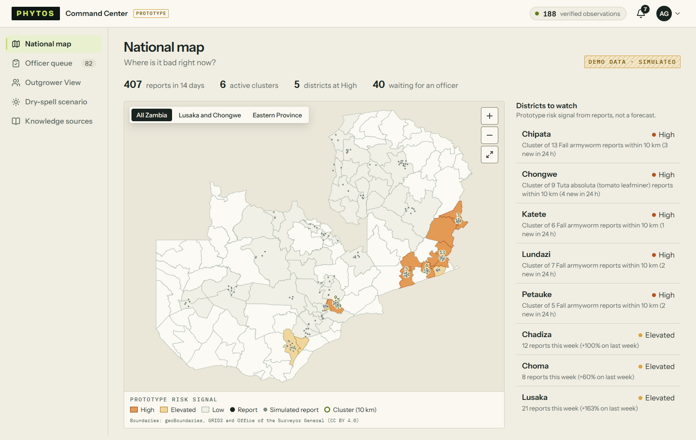
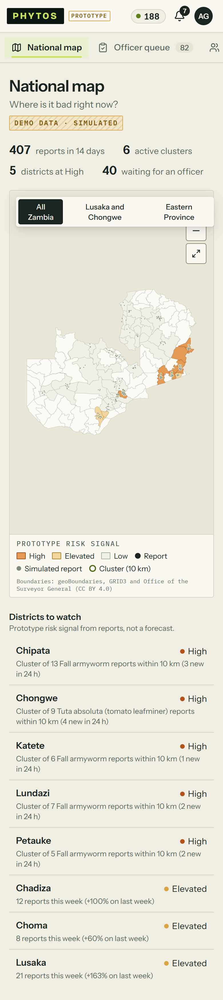
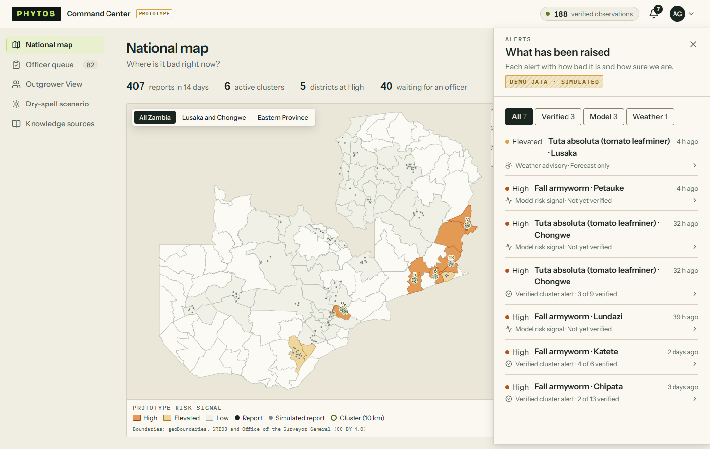
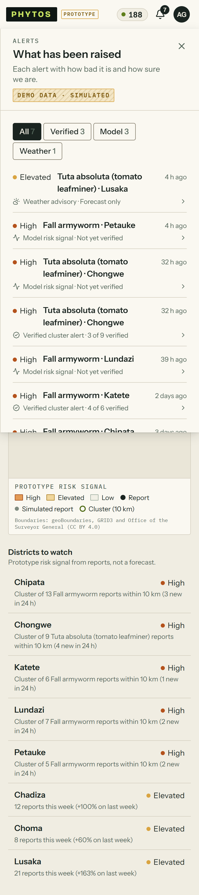
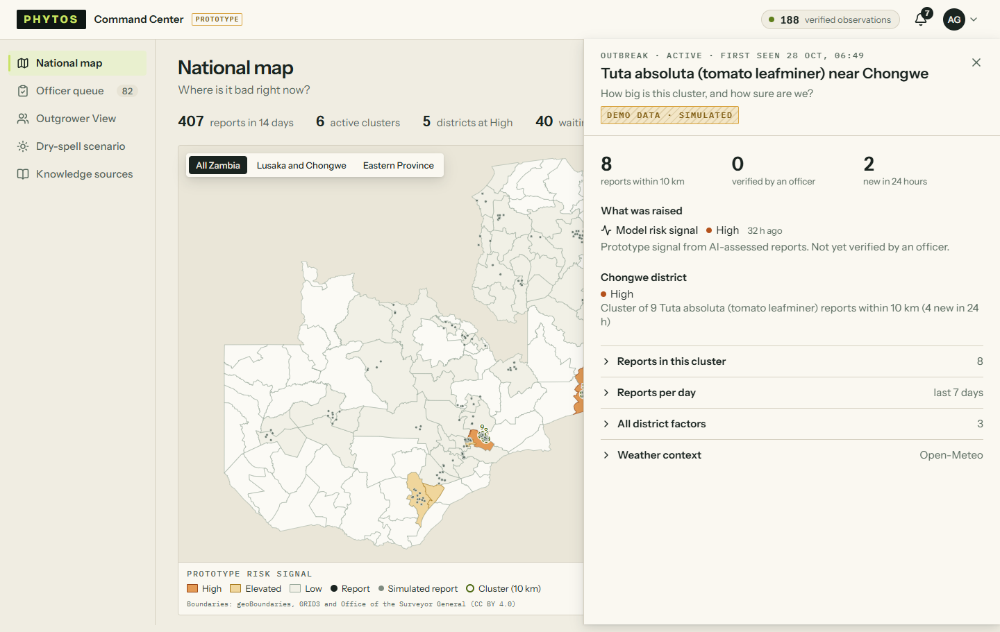
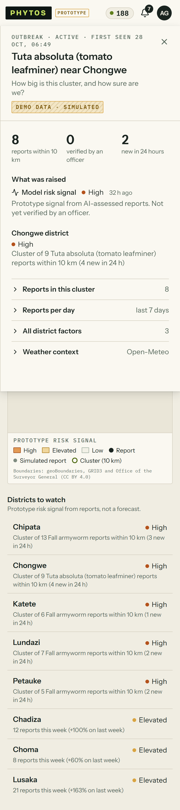
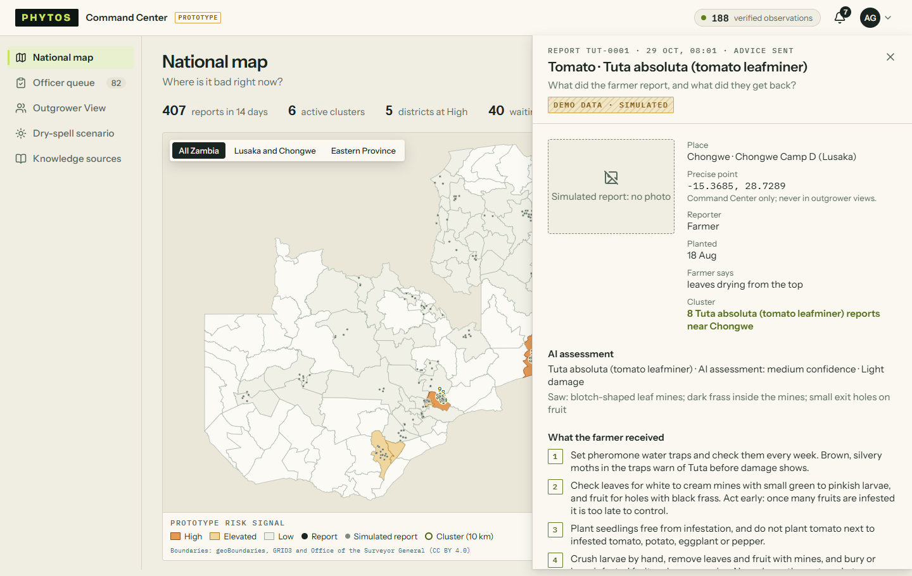
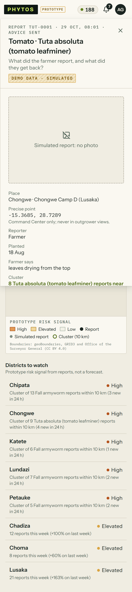

# Dashboard v2, increment 1: the map page and the drawers (structure)

Deployed to https://crop-watch01.web.app on 29 Oct. The demo check after the deploy passed: `outbreak-e2e` at the venue, report to alert sent in 10.0 s. The visual pass ran on all 16 view states at laptop (1440) and phone (390) widths and reported no issues (`visual-pass.md`). Every shot was then looked at on the contact sheets.

This increment changes **structure only**. The new visual language (neutral ground, one accent chosen from the research, amber and red for risk only) lands once `design-system/phytos/patterns-v2.md` is written.

What changed:

- **National map** answers one question, "Where is it bad right now?":
  - a slim stat strip;
  - the map, with its focus control floating on it;
  - one right rail of districts to watch. Clicking a district expands its factors in place and outlines it on the map.
  - Alerts are no longer on this page.
- **Alerts drawer** behind the header bell, which shows the count for the last 24 hours:
  - Each row shows the level dot, issue and district, and time, then the class and verification.
  - Factors, the full uncertainty sentence and the outbreak link are one click down.
  - Filters with counts sit above the list.
- **Outbreak drawer** over the map:
  - By default: size, verified, new in 24 hours, the alert with its uncertainty sentence, and the district signal.
  - Behind expanders: the reports, reports per day, all factors and the weather.
- **Observation drawer** over the page it was opened from:
  - photo and facts, the AI assessment in words, the advice sent, and the officer's verify;
  - the Evidence panel is behind "Why this advice?".
- **Loading states:** skeleton rows instead of "Loading…".
- **Fixes:**
  - The scenario toggle's knob slid out of its track when switched on.
  - Map keys were duplicated (Senanga has two parts).

Next: increment 2 is the Outgrower View visit lists (compact rows and a visit drawer), then the visual language and the remaining pages.

| View               | Laptop                                | Phone                                |
| ------------------ | ------------------------------------- | ------------------------------------ |
| National map       |          |          |
| Alerts drawer      |       |       |
| Outbreak drawer    |     |     |
| Observation drawer |  |  |

All 16 states: [sheet-laptop.png](sheet-laptop.png), [sheet-phone.png](sheet-phone.png).
