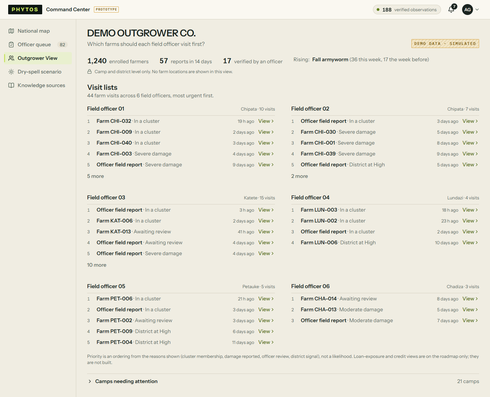
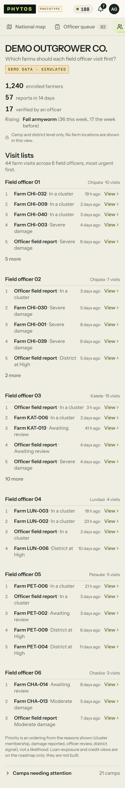
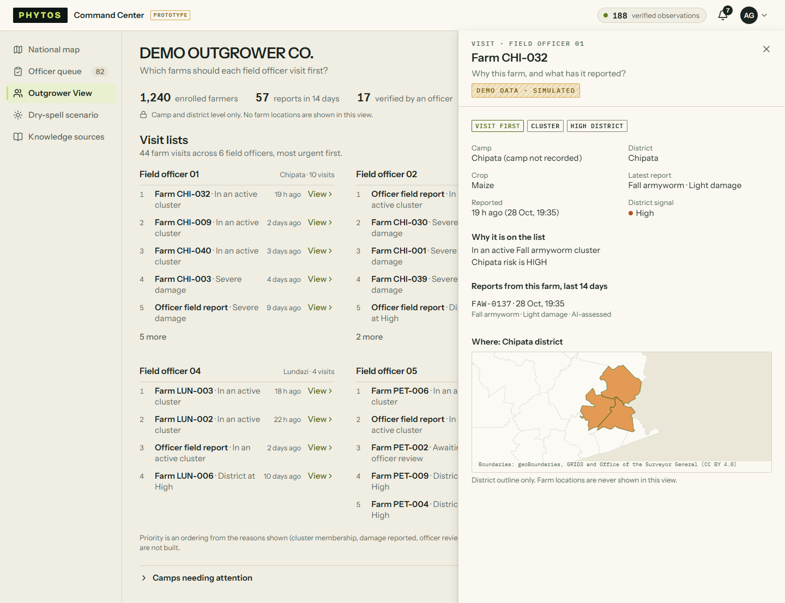
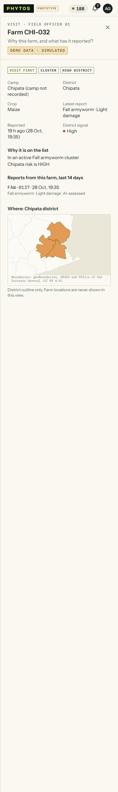

# Dashboard v2, increment 2: visit lists and the visit drawer

Deployed on 29 Oct with the API change it needs (`cropwatch-api-00010-f44`): visits now carry the farm's recent reports. After the deploy the demo check passed (`outbreak-e2e` at the venue, report to alert sent in 9.4 s). The visual pass found no issues on these views at either width.

What changed:

- **Outgrower View** answers "Which farms should each field officer visit first?".
  - **Columns:** each field officer gets a short ranked list, two columns side by side. Each farm is one line: rank, farm, the one top reason ("In a cluster", "Severe damage", "Awaiting review", "District at High"), age, and View. Five rows show, then "N more".
  - **Stat strip:** slim.
  - **Camps table:** behind an expander.
  - **Visible by default:** the privacy note (camp and district level only) and the priority note (an ordering, not a likelihood).
- **Visit drawer** (View):
  - the priority and every reason as chips;
  - camp, crop, the latest report and the district signal;
  - the reasons in full;
  - the farm's reports in the last 14 days;
  - a district locator map. It shows the district outline only: no farm location, per CLAUDE.md invariant 6.
- **API:**
  - visits gain an optional `history` field (tRPC only, additive);
  - report numbers for simulated reports read "FAW-0031", not "FAW-".

| View           | Laptop                              | Phone                              |
| -------------- | ----------------------------------- | ---------------------------------- |
| Outgrower View |  |  |
| Visit drawer   |      |      |
