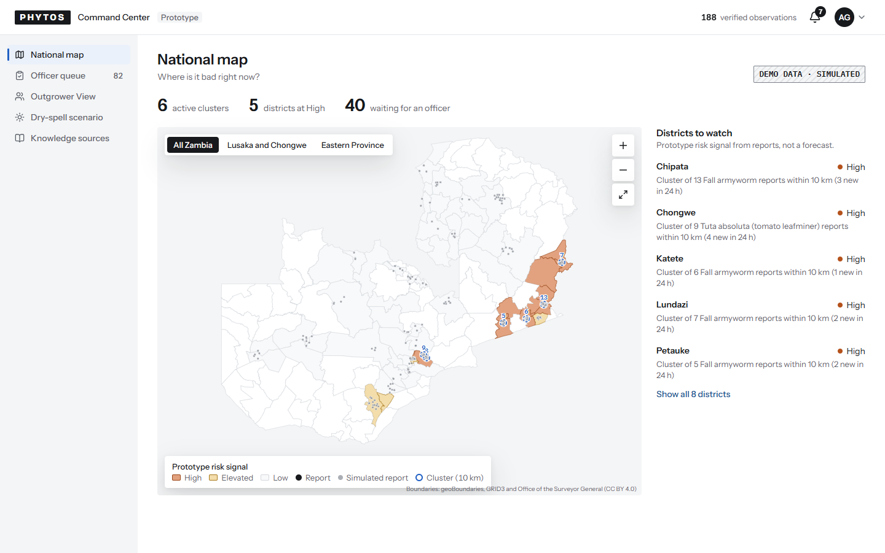
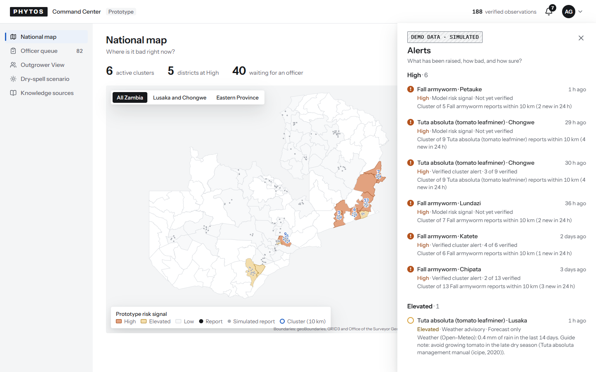
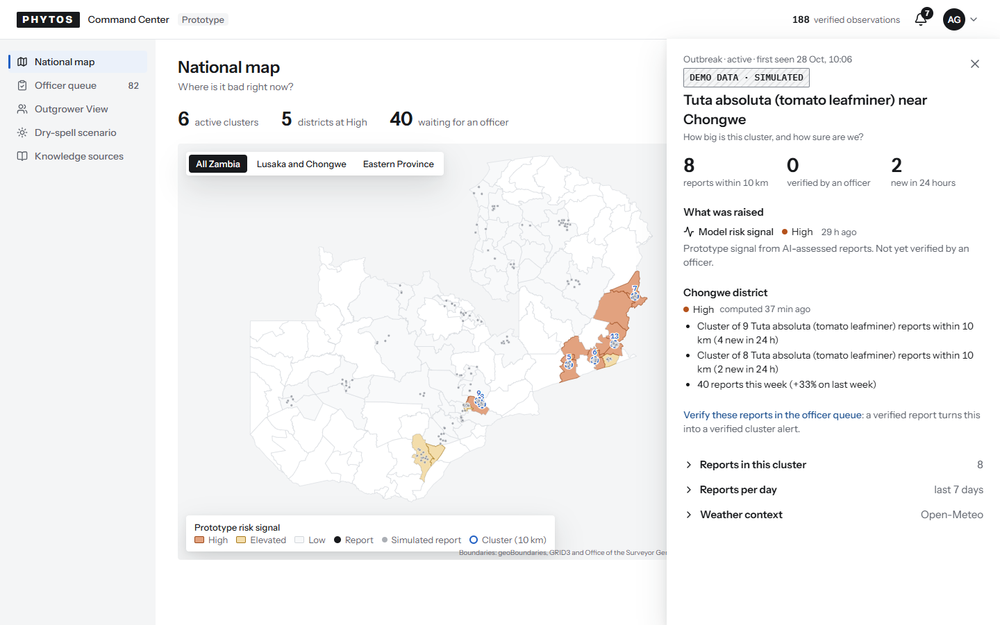
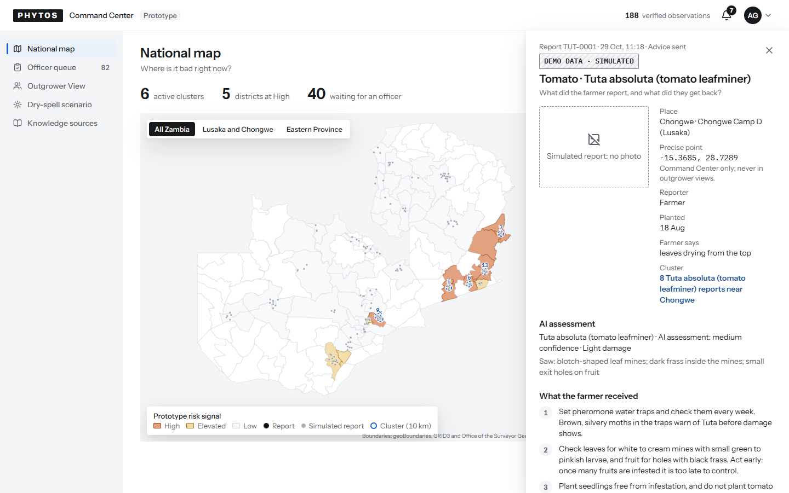
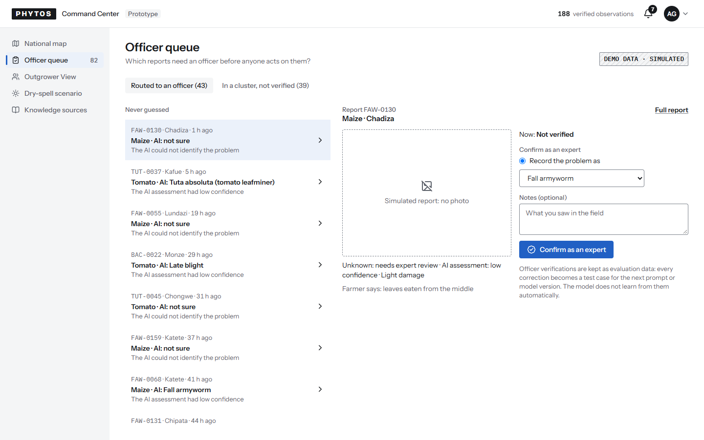
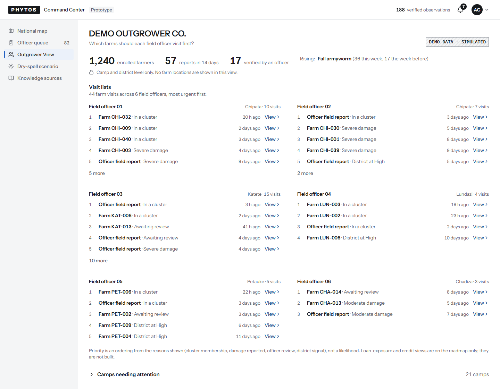
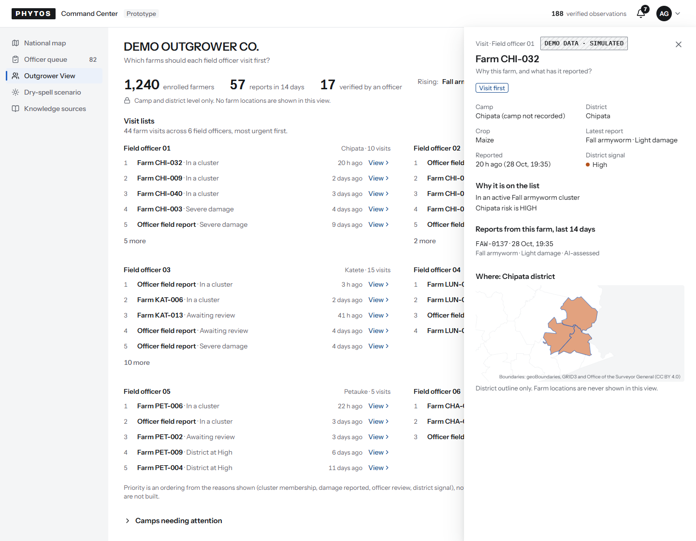
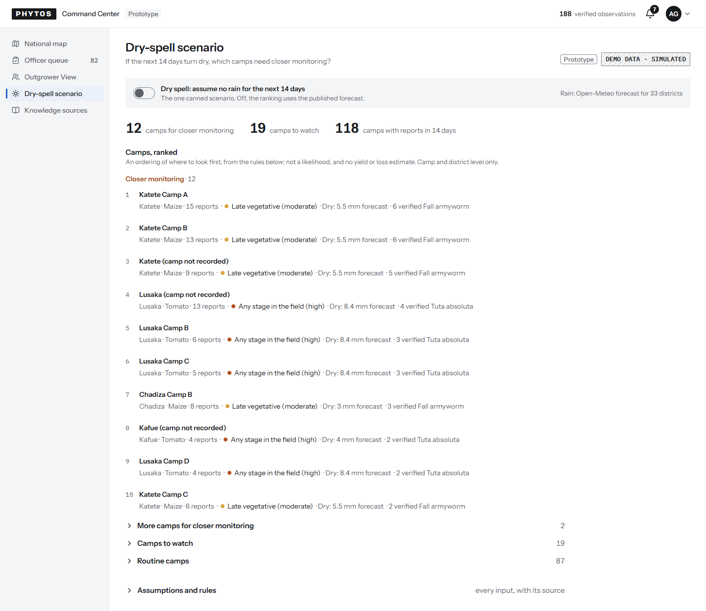

# Dashboard v2, increment 3: the visual language from the research

Deployed to https://crop-watch01.web.app on 29 Oct (dashboard only; the API is unchanged since increment 2). Checks:

- the demo check after the deploy passed (`outbreak-e2e` at the venue, report to alert sent in 12.1 s);
- the visual pass ran on all ten dashboard states at laptop and phone widths, with no issues, including the new measure of at most 8 bordered boxes and 3 hue families in view;
- every shot was looked at on the contact sheets.

The dashboard's HTML is now served `no-cache`, so a deploy shows at once. It was cached for an hour.

Source: `design-system/phytos/patterns-v2.md`. That research covers OneSoil's live public map, Grafana's live alert list, and Linear's and Stripe's closest public surfaces (their apps sit behind logins). It records what it could and could not observe.

What changed:

- **Theme.**
  - A white console with a rail grey.
  - Near-black ink.
  - One accent, blue `#2160C4`, for actions, links, focus, the current page and selection on the map. Green was ruled out because, under colour blindness, it can't be told apart from the risk colours.
  - Amber and red-gold are for risk only: the DEMO badge, the Prototype badge, tier labels and error text went neutral.
- **Type.**
  - Instrument Sans throughout, with a 14 px body and tabular figures.
  - Mono only for ids, doses and coordinates; Bricolage only in the wordmark.
  - Sentence case everywhere except the fixed DEMO badge.
- **Fewer boxes.**
  - Borders only on controls, the header edge and tables of four or more columns.
  - Lists, rails, panels and expanders group by space and weight.
  - Drawers have a shadow instead of a border.
- **Alerts drawer** (after Grafana):
  - grouped High and Elevated with counts, Low on request;
  - each row has a level icon that differs in shape as well as colour, title, age; then level, class and verification; then the first factor in full.
  - A row opens its outbreak in the same drawer, with "Back to alerts".
  - The bell counts High and Elevated alerts not yet opened in this browser.
- **Drawers:**
  - 480 px;
  - focus returns to whatever opened them;
  - one drawer at a time.
  - The outbreak drawer shows every district factor by default (invariant 2) and links to the officer queue.
- **Map:**
  - white land, amber and red-gold risk fills, ink report dots, blue cluster rings and selection;
  - the legend floats inside the map (under it on phones);
  - three figures;
  - the top five districts, with "Show all".
- **Scenario:**
  - the closer-monitoring group has a heading instead of a chip on every row;
  - the top ten show, the rest one click down.
- **Loading:** skeleton bars appear only after 250 ms.

Departures from the research, on purpose:

- **Legend:** always visible, because a projector audience reads the map without clicking.
- **Officer queue:** newest first, so the presenter's report is at the top on stage.
- **Visit lists:** every officer's column stays open, as you asked.

| View               | Laptop                                |
| ------------------ | ------------------------------------- |
| National map       |          |
| Alerts drawer      |       |
| Outbreak drawer    |     |
| Observation drawer |  |
| Officer queue      |        |
| Outgrower View     |    |
| Visit drawer       |        |
| Dry-spell scenario |     |

Phone: [map](dashboard-map-phone.png). All states at both widths: [sheet-laptop.png](sheet-laptop.png), [sheet-phone.png](sheet-phone.png).
