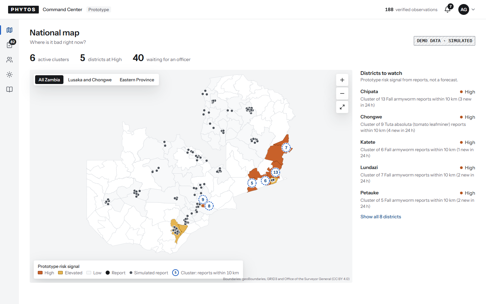
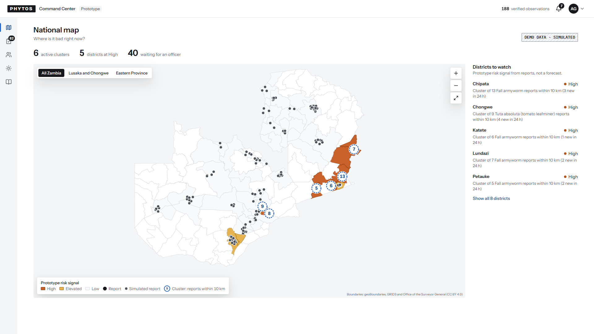
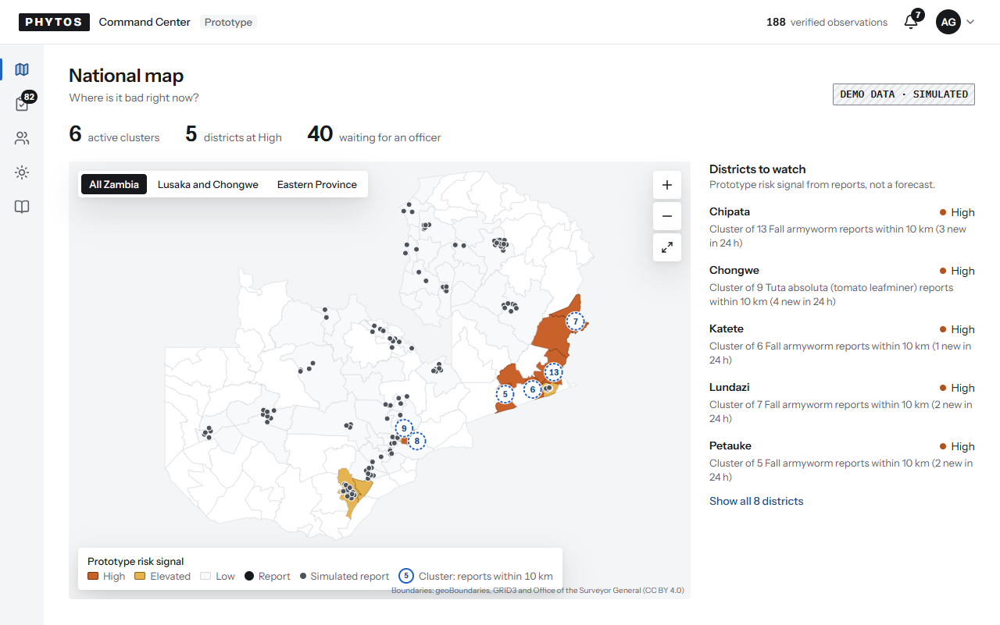
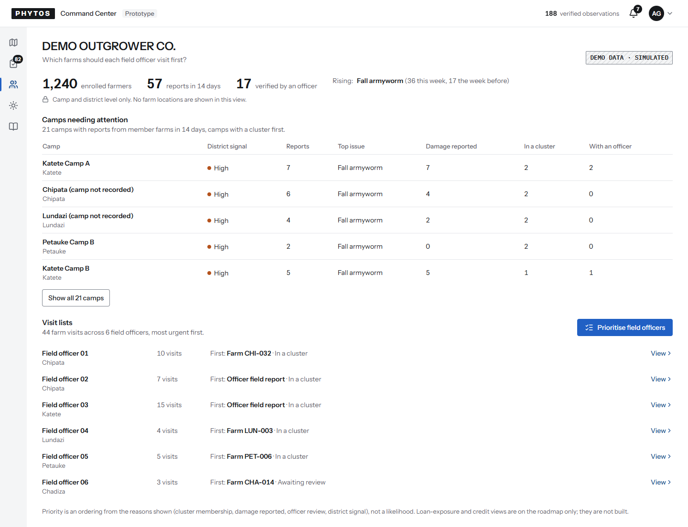
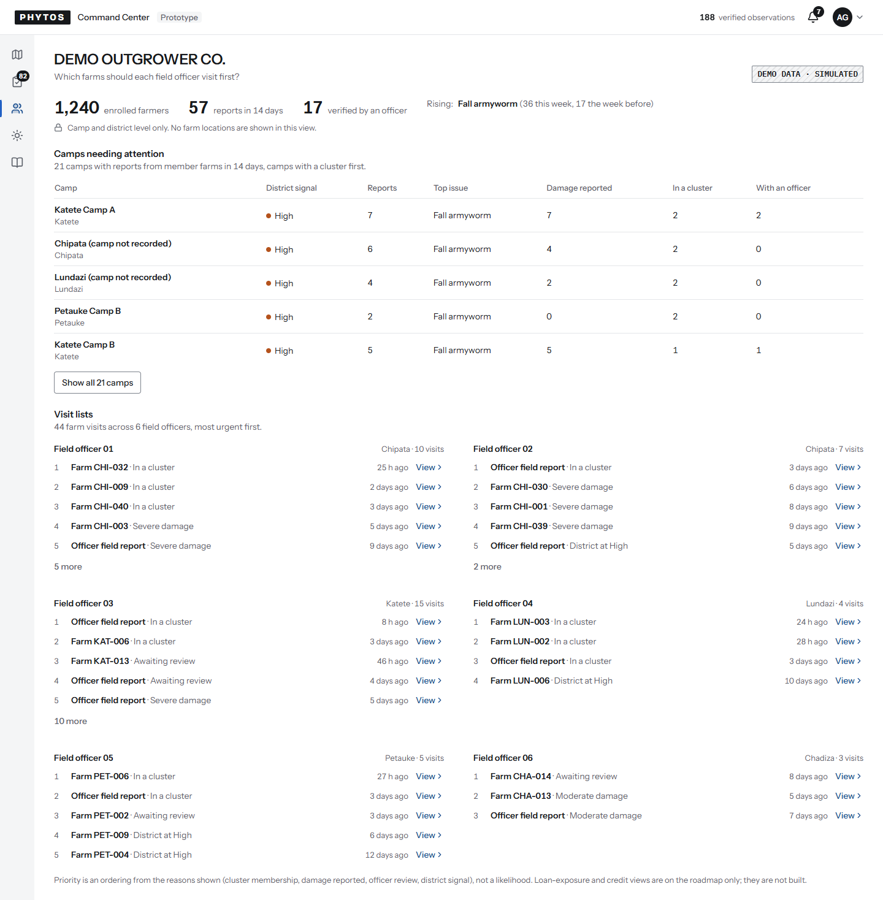
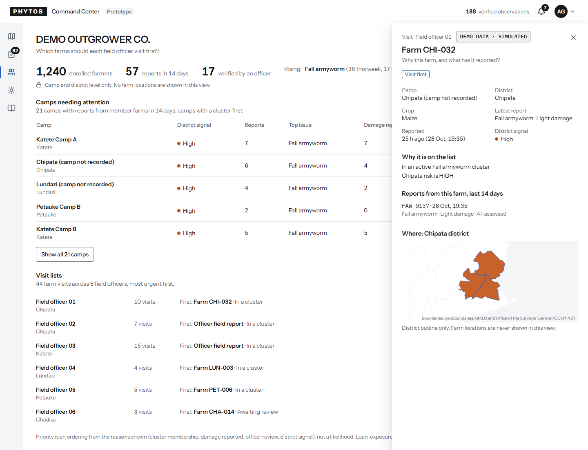
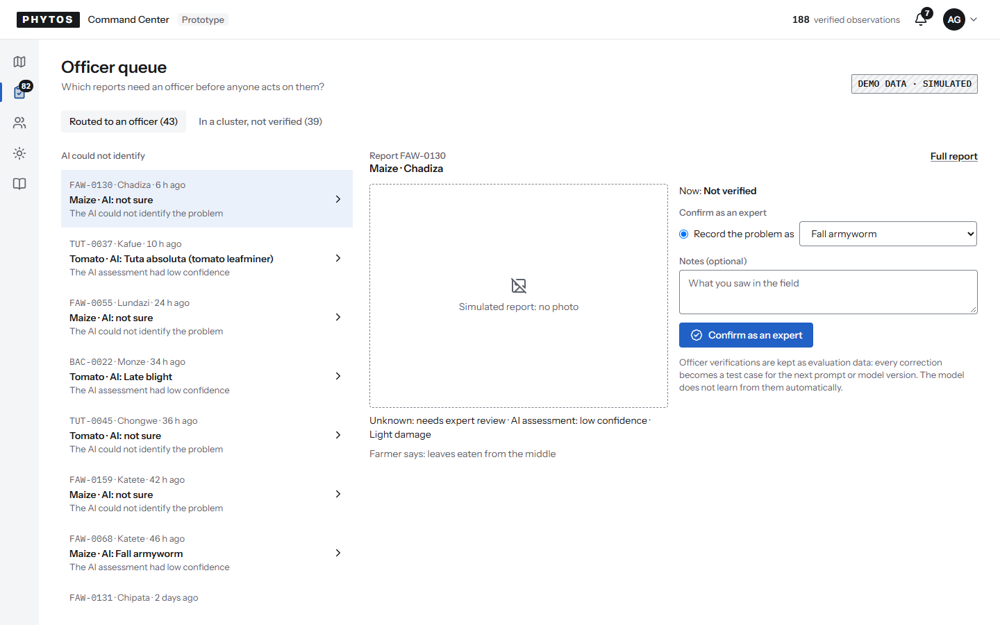
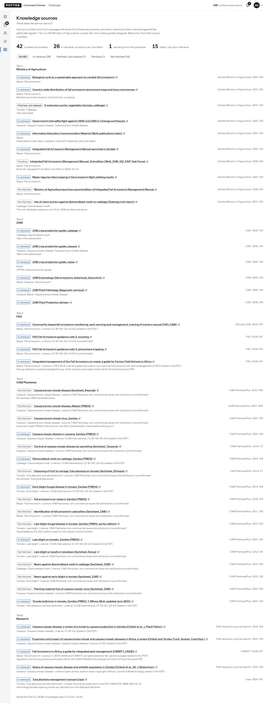

# Dashboard v2.1: Geoffrey's review of v2, applied

Deployed to https://crop-watch01.web.app on 29 Oct (dashboard only; the API is unchanged, `cropwatch-api-00010-f44`). Commit `1f0d499` on `d9-dashboard-v2`. Checks:

- the demo check after the deploy passed (`outbreak-e2e` at the venue: report to alert 8.1 s, report to dispatch 11.9 s; cleaned up, so the demo stays armed);
- the full repo gate is green (typecheck, lint, build, 392 tests);
- the visual pass ran on all 17 states at laptop and phone widths, plus the map at two projector sizes, with no issues;
- every shot was looked at.

v2 is the keeper structure. These four changes are all that changed. Saturday at the venue is point-and-fix polish on this structure; the map as a full canvas is on the post-event list.

1. **Outgrower View, never empty on first paint.**
   - "Camps needing attention" is open on load: the top 5 camps, then "Show all 21 camps".
   - Below it, one line per field officer: officer and district, visit count, the farm to visit first with its reason, and View, which opens the visit drawer.
   - "Prioritise field officers" still opens the full ranked lists, as in the runbook.
   - On phones the camps table shows its first four columns, so nothing is cut off at the edge.
2. **Map, the projector view.**
   - The map is about 70% of the screen height, at least 480 px.
   - Report dots are twice the radius, and simulated dots are dark grey.
   - High and Elevated fills are stronger.
   - A cluster is one ring with its count inside. Overlapping badges (Lusaka and Chongwe at the national view) are nudged apart.
   - The region toggle is unchanged. On a 1080p screen the map page now uses the full width instead of a centred 1320 px column.
3. **Slim icon rail** (after OneSoil).
   - 56 px wide from 1024 px, with tooltips.
   - The current page has a filled icon and a bar; the queue count is a badge on its icon.
   - The width went to the content. Phones keep the labelled strip.
4. **Copy.**
   - "Never guessed" is now "AI could not identify".
   - The publisher column on Knowledge sources is in the body sans.

To decide on Saturday: the routed list also holds reports the AI did identify but with low confidence (for example "AI: Tuta absoluta · The AI assessment had low confidence"). Under the heading "AI could not identify", those rows read as a contradiction. "AI could not identify, or was unsure" fixes it in one edit.

| View                                | Laptop                                          |
| ----------------------------------- | ----------------------------------------------- |
| National map                        |                    |
| National map, projector 1920 x 1080 |            |
| National map, projector 1280 x 800  |            |
| Outgrower View, first paint         |              |
| Outgrower View, after Prioritise    |  |
| Visit drawer                        |                  |
| Officer queue                       |                  |
| Knowledge sources                   |                |

Phone: [map](dashboard-map-phone.png), [Outgrower View](dashboard-outgrower-phone.png). All states at both widths: [sheet-laptop.png](sheet-laptop.png), [sheet-phone.png](sheet-phone.png). Check results: [visual-pass.md](visual-pass.md).
