# UI review, 29 Oct 2026 (b): the final UI pass before the pitch

The same 12 views, before (this morning's "Field Signal" night console, `docs/ui-review/2026-10-29-field-signal/`) and after (tag `freeze-2026-10-29b`). Same preview fixtures, same viewports: capture at 390 px, Command Center at 1440 px. UI only; the demo path is unchanged. Patterns come from `design-system/phytos/patterns.md` (OneSoil, John Deere Operations Center, Climate FieldView, xarvio, Linear, Stripe).

What changed:

- **Command Center on the light day exposure.** Hotel projectors wash out dark grounds.
- **Header:**
  - wordmark and a smaller prototype badge on the left;
  - the verified-observations chip on the right;
  - an initials avatar that opens the account menu (email, role, sign out).
  - No email in the chrome.
- **Mono caps only on kickers, chips and stat labels.** Nav, table headers, form labels, buttons and body are sentence case.
- **Nav:**
  - icons and sentence-case labels;
  - a chartreuse bar and tint on the current page;
  - quiet grey counts.
- **Lists:**
  - at most two chips and two lines per row;
  - severity is a coloured dot and a word;
  - "High district" folds into the reason line.
  - Districts to watch are two lines each.
  - Nothing ends in "…".
- **Stat row as on the pitch PDF:** a big Bricolage number with a two-line label beside it.
- **Spacing:** an 8 px grid, 24 px panels and a 1320 px maximum width.
- **Map on a light ground:**
  - paper basemap with moss outlines;
  - gold and amber risk fills;
  - dark report dots;
  - deep-leaf cluster rings;
  - the selected district outlined, and its row tinted, in deep leaf.
- **Capture:**
  - same layouts;
  - field and form labels and report metadata in sentence case;
  - kickers unchanged.

| View                               | Before (Field Signal, night)                                 | After (freeze-2026-10-29b)        |
| ---------------------------------- | ------------------------------------------------------------ | --------------------------------- |
| Capture: camera                    |          | 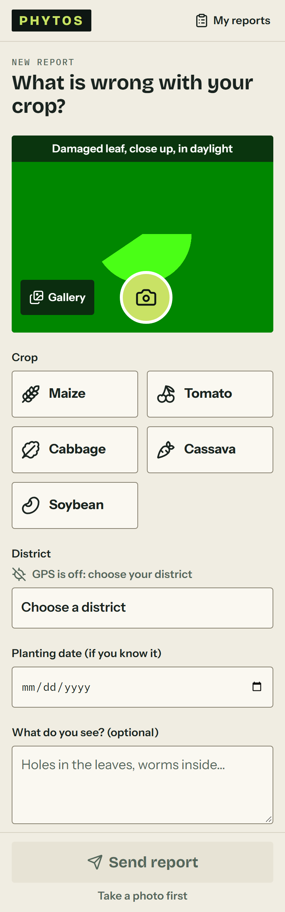         |
| Capture: ready to send             |  | 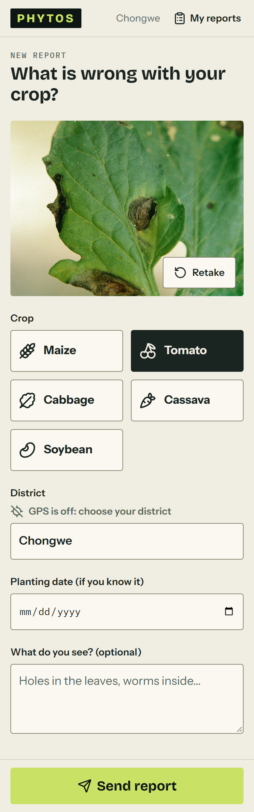 |
| Capture: report sent               |     |     |
| Capture: result and advice         |   | 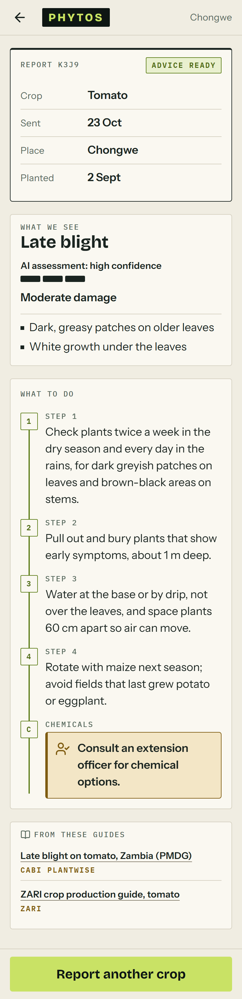  |
| Capture: with an officer           |  | 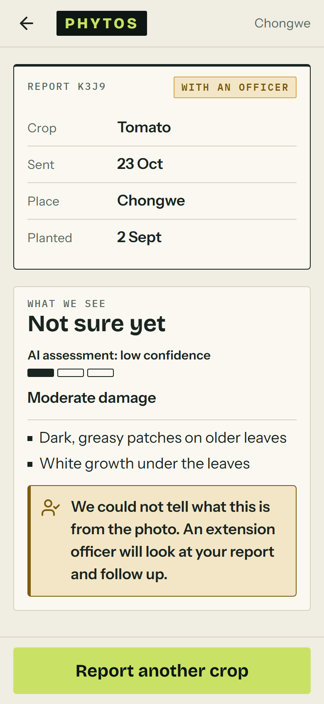 |
| Capture: home and area alerts      |     | 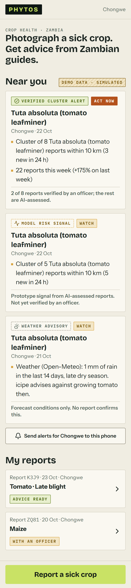    |
| Command Center: national map       |             | 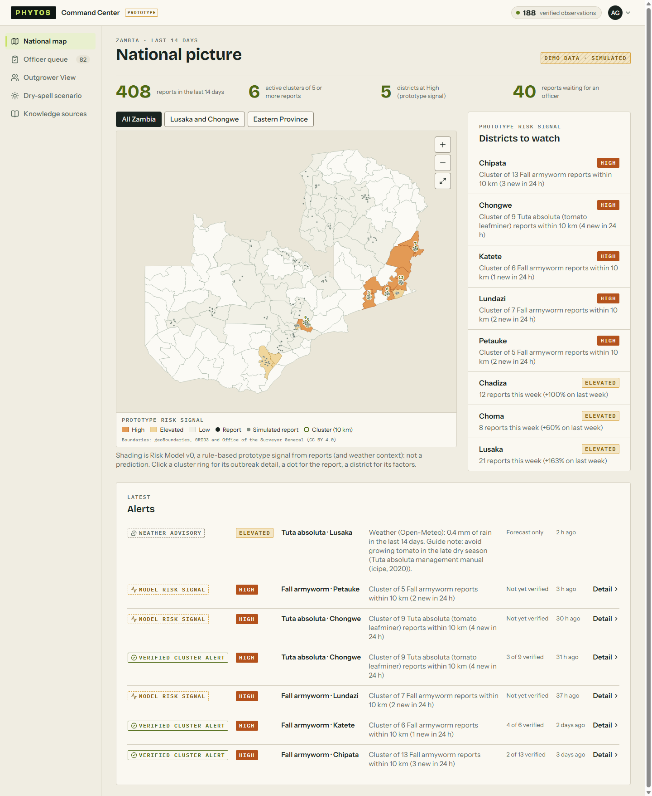            |
| Command Center: outbreak detail    |        | 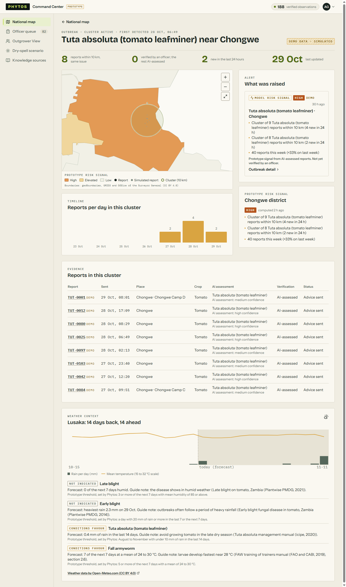       |
| Command Center: observation detail |     | 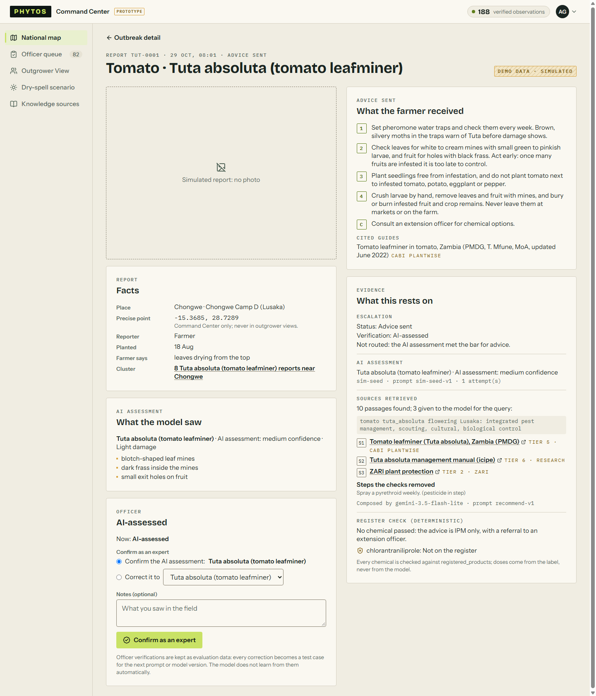    |
| Command Center: officer queue      |           | 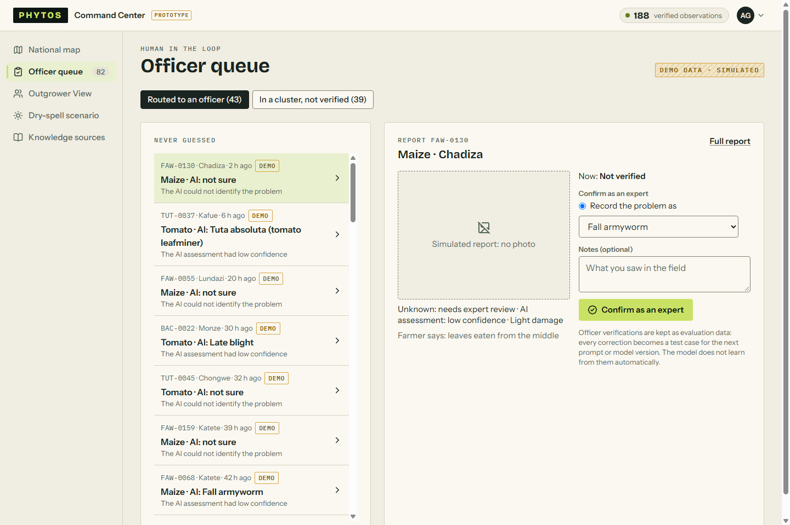          |
| Command Center: Outgrower View     |       | 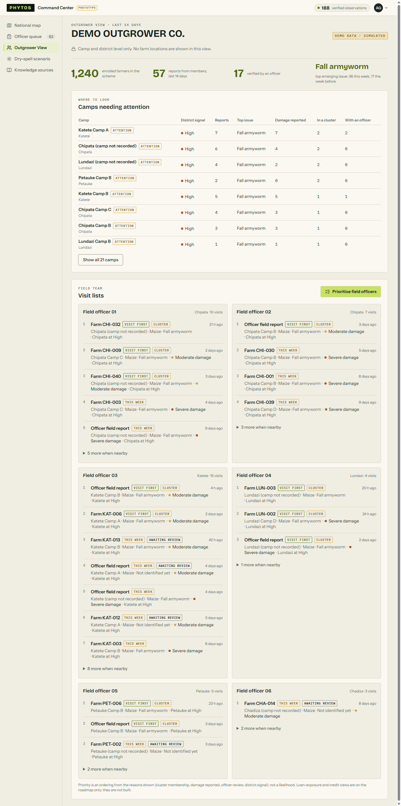      |
| Command Center: knowledge sources  |         | 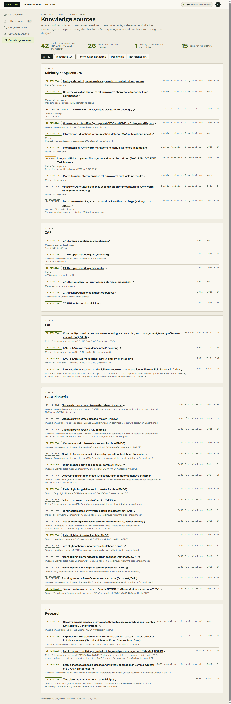        |
| Dry-spell scenario (flagged)       | 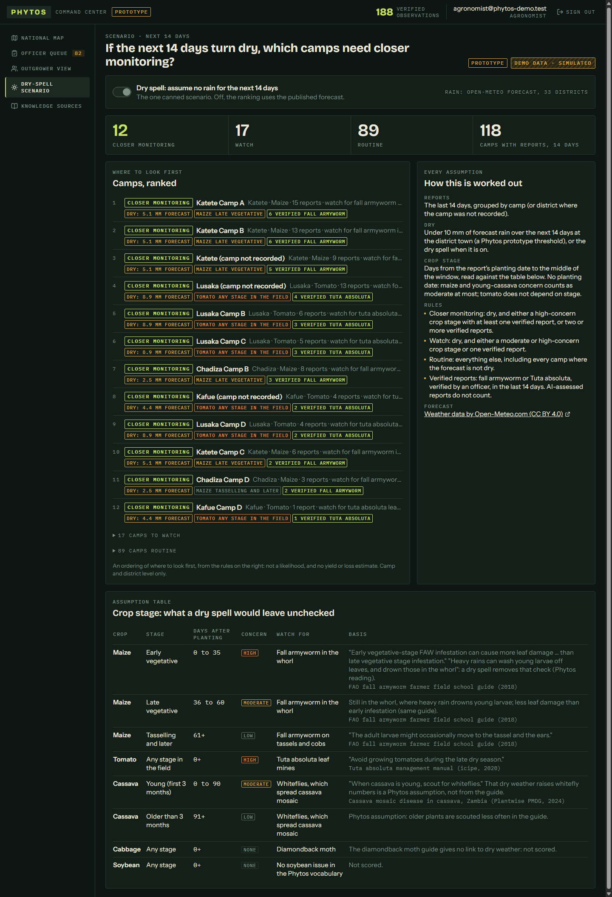       | 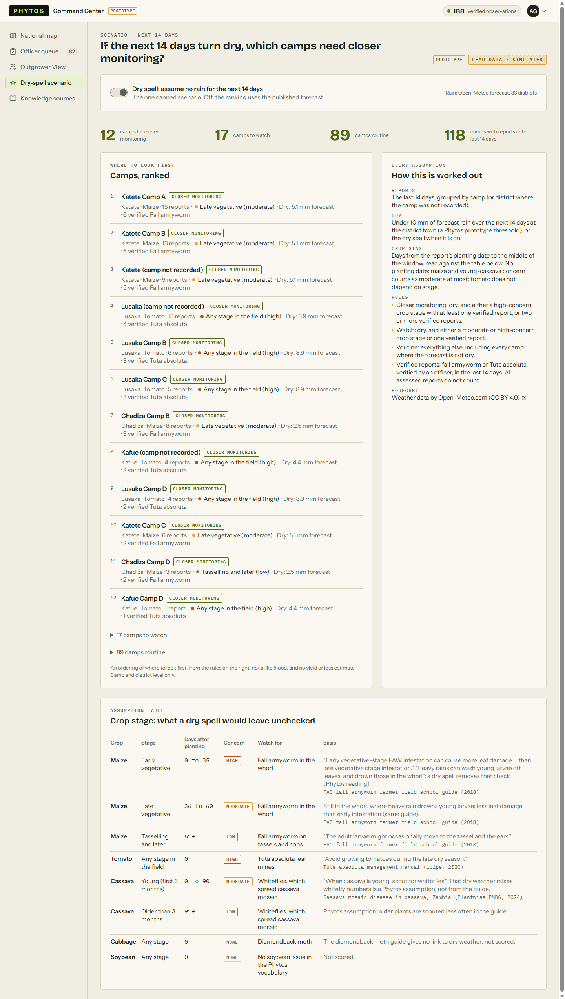       |

After this tag, UI feedback goes to `docs/ui-feedback-log.md` and is not built until after the final pitch.
